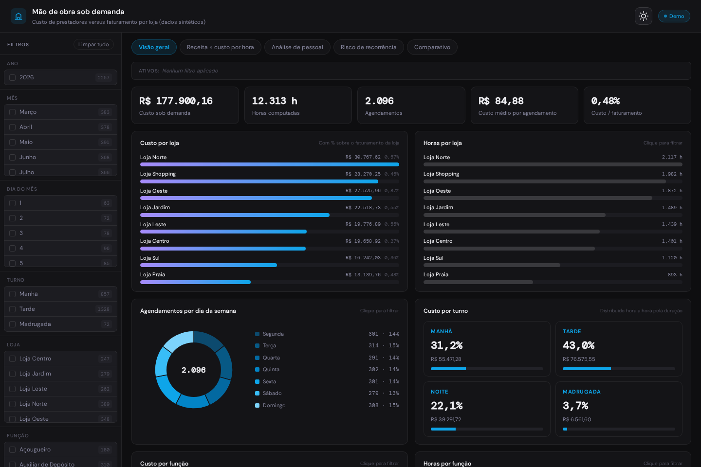
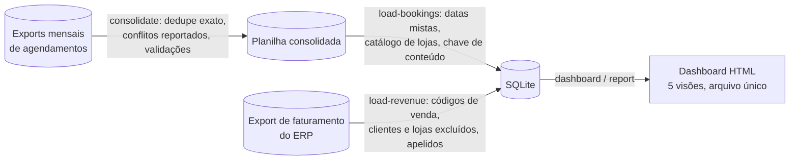
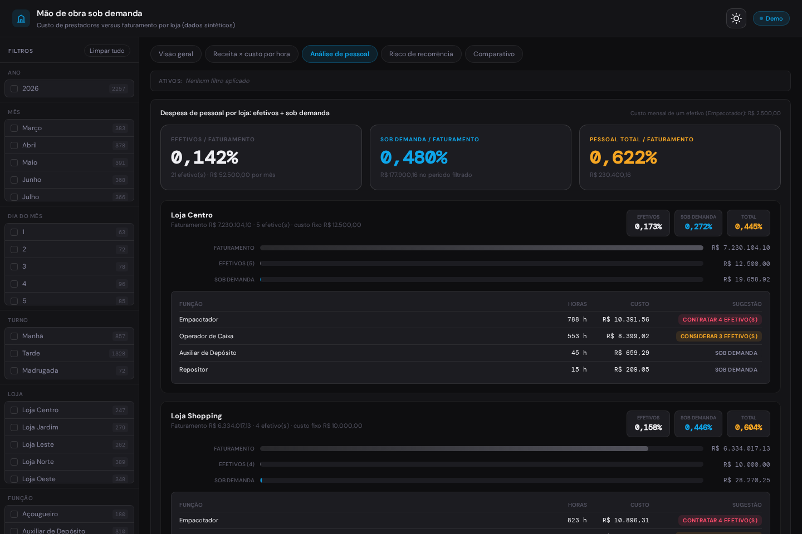

# Mão de obra sob demanda: custo por loja versus faturamento

[](https://github.com/DerickxP/on-demand-staffing-analytics/actions/workflows/ci.yml)


Pipeline que **consolida os agendamentos de trabalhadores sob demanda** (plataforma de
mão de obra por hora) com o **faturamento por loja exportado do ERP**, grava tudo em
SQLite e gera um **dashboard de cinco visões em um único arquivo HTML**: custo por loja
e por turno, receita versus custo hora a hora, análise de pessoal com sugestão de
contratação, risco de recorrência de prestadores e comparativo entre períodos.

> Projeto de portfólio sobre um cenário hipotético: uma rede varejista fictícia que
> contrata mão de obra por hora. Todos os dados, lojas, prestadores e regras são
> sintéticos e gerados pelo próprio projeto. A demonstração roda
> inteira sem nenhuma fonte externa.



---

## O problema

Uma rede de lojas usa uma plataforma de trabalho sob demanda para cobrir picos:
empacotadores, operadores de caixa, repositores, contratados por turno. A gestão precisa
responder, todo mês, a perguntas que as planilhas exportadas não respondem sozinhas:

- **Quanto cada loja gasta com mão de obra sob demanda e quanto isso representa da
  receita da loja?** Os agendamentos vêm da plataforma e o faturamento vem do ERP, com
  nomes de loja diferentes em cada sistema.
- **Em que horários o custo se concentra em relação à venda?** Um turno das 18h com seis
  horas atravessa cinco faixas horárias; somar tudo na hora de início distorce a leitura.
- **Vale a pena contratar efetivos?** Uma função que consome 200 horas sob demanda por
  mês em uma loja pode custar mais do que um funcionário fixo.
- **Algum prestador virou rotina?** Trabalhar quase toda semana, vários dias, na mesma
  loja, caracteriza vínculo empregatício. Isso é risco jurídico, não só custo.

E, antes de qualquer análise, os dados chegam quebrados:

- **Datas misturadas na mesma coluna** (data real do Excel, texto ISO e texto brasileiro).
  Converter tudo com "dia primeiro" inverte dia e mês do texto ISO e cria agendamentos
  em meses futuros, silenciosamente.
- **Lojas renomeadas no ERP** no meio do ano. O nome novo não está no mapeamento e a loja
  aparece duplicada: histórico antigo com um nome, mês novo com outro.
- **O export do ERP traz tudo**, não só vendas: movimentações internas, devoluções, um
  cliente fictício do autoatendimento, balcão de atacado. Sem filtrar, o "faturamento"
  não bate com o BI.
- **Vários exports por período se sobrepõem** e, às vezes, a mesma referência aparece com
  dados diferentes.

## A solução



| Etapa | Comando | O que faz |
| --- | --- | --- |
| Consolidação | `staffing-analytics consolidate` | Une os exports de uma pasta; remove só duplicatas exatas; conflitos vão para a aba `CONFLITOS`; aborta se alguma validação falhar |
| Agendamentos | `staffing-analytics load-bookings` | Normaliza colunas, datas mistas, mapeia lojas, descarta balcão e datas impossíveis, carga idempotente |
| Faturamento | `staffing-analytics load-revenue` | Aplica os códigos de venda, exclusões de cliente e loja, apelidos e detecção de renomeação |
| Dashboard | `staffing-analytics dashboard` | Gera o HTML com dados embutidos |
| Relatório | `staffing-analytics report` | Resumo no terminal: custo por loja, risco de recorrência, sugestões de contratação |
| Tudo | `staffing-analytics pipeline` | Executa as etapas em sequência |
| Demo | `staffing-analytics demo` | Gera dados sintéticos e roda o pipeline inteiro |

## Arquitetura

```text
src/staffing_analytics/
├── cli.py                    # subcomandos; cada etapa roda isolada
├── config.py                 # regras do negócio em config.json validado (sem segredos)
├── etl/
│   ├── consolidate.py        #   união de exports com validações e aba de conflitos
│   ├── dates.py              #   datas mistas sem trocar dia por mês; trava de futuro
│   ├── stores.py             #   catálogo de lojas: apelidos, exclusões, renomeações
│   ├── bookings.py           #   normalização dos agendamentos e do quadro fixo
│   ├── revenue.py            #   normalização do faturamento do ERP
│   ├── schema.py             #   DDL do SQLite
│   └── load.py               #   carga incremental por chave de conteúdo
├── analytics/
│   ├── metrics.py            #   regras de negócio puras: turnos, recorrência, contratação
│   ├── report.py             #   relatório de terminal
│   └── export.py             #   monta o HTML único
├── dashboard/assets/         # template.html, styles.css, app.js (SVG puro, sem libs)
└── demo/synthetic.py         # dados sintéticos com "verdade" conhecida
```

## Decisões de projeto

**Regras do negócio fora do código.** Códigos de operação que contam como venda, clientes
e lojas excluídos, apelidos de loja, custo de um efetivo, jornada mensal e limiares de
risco ficam em `config.json`. Trocar de ERP ou de política é editar o arquivo.

**Datas tratadas por origem.** `dates.parse_mixed_dates` converte data real, texto ISO e
texto brasileiro separadamente e devolve estatísticas (quantos vieram em texto, quantos
se perderam). Uma trava descarta agendamentos além de um horizonte configurável, porque
"agendamento daqui a oito meses" é quase sempre dia e mês trocados.

**Catálogo de lojas com detecção de renomeação.** O nome no ERP começa com o número da
loja. Um nome desconhecido cujo número já existe no cadastro é reportado como provável
renomeação, com os nomes conhecidos para comparação. Adicionado o apelido, a carga
seguinte consolida o histórico já gravado sem recriar o banco.

**Consolidação conservadora.** Só linhas 100% iguais são descartadas. A mesma referência
com dados diferentes é mantida e reportada. Quatro validações (contagem, referências,
duplicatas, contribuição de cada arquivo) precisam passar para o arquivo ser gerado.

**Idempotência por chave de conteúdo.** Cada agendamento e cada linha de faturamento
recebe um hash; a carga usa `INSERT OR IGNORE`. Reprocessar não duplica.

**Custo distribuído hora a hora.** Para comparar com a venda por faixa horária, o custo
de cada agendamento é repartido pelas horas que ele atravessa, a partir da hora de início.

**Risco de recorrência por semana ISO.** Para cada prestador, o pico de dias distintos
trabalhados em uma mesma semana define o risco (limiares configuráveis). O dashboard
abre a escala completa da pessoa ao clicar na linha.



**Sugestão de contratação explicável.** Horas sob demanda ÷ jornada mensal = equivalentes
de jornada completa. Para a função de referência, compara-se o custo sob demanda com o
custo de contratar o número inteiro de efetivos equivalente; os limiares estão no config.

**Mesmas regras em Python e no navegador.** As métricas existem em `metrics.py`, com
testes, e são espelhadas em `app.js` para os filtros cruzados funcionarem sem servidor.

## Como rodar

### Demonstração

```bash
pip install -e ".[dev]"
staffing-analytics demo --output-dir demo_output
```

Abra `demo_output/output/dashboard.html`. A demo gera seis meses de exports com
sobreposição e um conflito, a planilha de faturamento com tudo o que precisa ser filtrado
e uma loja renomeada no meio do período, e grava o `config.json` efetivo em
`demo_output/` para você ver as regras aplicadas.

### Uso real

1. Copie `config.example.json` para `config.json` e ajuste caminhos, códigos de venda,
   exclusões, apelidos e parâmetros de pessoal.
2. Coloque os exports da plataforma em `data/bookings/` (um `.xlsx` por período, aba `BD`,
   mais as abas `MapeamentoLojas` e `QuadroCLT` em pelo menos um deles).
3. Coloque o export do ERP em `data/revenue.xlsx` (aba `BD` e aba `Lojas` de mapeamento).
4. Rode `staffing-analytics pipeline`. Para reprocessar sem consolidar de novo, use
   `--skip-consolidate`.

### Formato das planilhas

| Arquivo | Aba | Colunas principais |
| --- | --- | --- |
| Agendamentos | `BD` | Nome, Estado, Loja, Vaga, Início, Término, Ref Agendamento, Agendado em, Iniciado em, Concluido em, Valor, Fração de hora computada, Status, Data do cancelamento, Motivo, Responsável pelo cancelamento |
| Agendamentos | `MapeamentoLojas` | Loja Sistema (nome na plataforma), Loja (nome canônico) |
| Agendamentos | `QuadroCLT` | Loja, Efetivos |
| Faturamento | `BD` | Empresa, Cliente, Data, Dia da Semana, Hora do Dia, CGO, Quantidade, Valor Bruto, Valor Desconto, Valor Liquido |
| Faturamento | `Lojas` | Lojas no Sistema (nome no ERP), Lojas no Banco (nome canônico) |

Nomes de abas e colunas aceitam variações de acento e caixa. Telefone e outros dados
pessoais dos prestadores não entram no banco por decisão de projeto.

## Modelo de dados

| Tabela | Chave | Conteúdo |
| --- | --- | --- |
| `bookings` | `booking_key` (referência da plataforma ou pessoa+início+loja) | Agendamento com custo, horas computadas, status e cancelamento |
| `revenue` | `revenue_key` (loja+data+hora+código+quantidade+valor) | Faturamento líquido por loja, data, hora e operação |
| `headcount` | `store` | Efetivos da função de referência por loja |

Detalhes em [docs/architecture.md](docs/architecture.md) e [docs/data-model.md](docs/data-model.md).

## Testes e CI

```bash
ruff check .
pytest
```

A suíte cobre datas mistas (o caso exato do dia e mês invertidos), catálogo de lojas e
detecção de renomeação, consolidação com conflitos e validações, filtros do faturamento,
idempotência e consolidação de histórico ao adicionar apelidos, distribuição de custo por
hora, risco de recorrência, sugestão de contratação, geração do HTML e o pipeline ponta a
ponta contra a verdade do gerador sintético (quem tem perfil de alta recorrência precisa
sair como crítico; a loja renomeada precisa aparecer uma vez só). O GitHub Actions roda
lint, testes e a demo em Python 3.10 e 3.12.

## Limitações e evolução

- A análise de pessoal usa um custo mensal médio por efetivo; encargos e benefícios
  variáveis não são modelados.
- Homônimos entre prestadores são tratados como a mesma pessoa; a plataforma de origem
  deveria fornecer um identificador estável.
- Próximos passos naturais: histórico de quadro fixo com vigência, exportação para
  Parquet/DuckDB e alertas automáticos de recorrência por e-mail.

## Licença

MIT. Veja [LICENSE](LICENSE).
